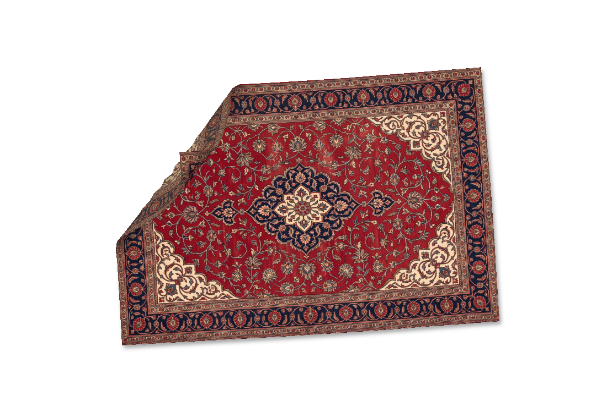

# Under the Rug for Windows

Ковер с физикой ткани поверх значков рабочего стола Windows. Поднимите угол, загляните под него, сложите или переверните ковер мышью.

Неофициальный Windows-порт [siliconbag/under-the-rug](https://github.com/siliconbag/under-the-rug). Исходный алгоритм ткани и текстуры сохранены; интерфейс, отрисовка и интеграция с Проводником реализованы на C#, WPF и Win32.



## Возможности

- Ткань со складками, самоколлизиями и буграми над настоящими значками.
- Перетаскивание левой кнопкой, поворот колесом, меню по правому клику.
- Четыре ковра, загрузка своего JPEG/PNG/BMP и три варианта деревянного пола.
- Сбор значков под ковер с сохранением и восстановлением исходных координат.
- Сохранение размера, положения, угла и выбранной текстуры.
- Автозапуск при входе в Windows без открытия настроек.
- Значок в системном трее и остановка анимации, когда ткань успокоилась.

## Требования

Windows 10 или Windows 11 **x64**, стандартный рабочий стол Explorer и .NET Framework 4.8. Отдельно устанавливать .NET SDK, Visual Studio или пакеты NuGet для сборки скриптом не требуется.

Проверено на Windows 11 x64. Windows 10 — целевая платформа; отдельный прогон на ней не выполнялся. Приложение запускается без прав администратора.

## Запуск готовой программы

[Скачать готовую сборку для Windows x64](https://github.com/chertovshina/under-the-rug-windows/releases/latest) — `RugWindows-1.1.0-win-x64.zip`.

1. Распакуйте архив целиком.
2. Запустите `RugWindows\RugWindows.exe`.
3. Оставьте папку `Resources` рядом с EXE.

Приложение не имеет цифровой подписи: Windows SmartScreen может показать предупреждение о неизвестном издателе. Если готового релиза еще нет, соберите программу по инструкции ниже.

## Управление

| Действие | Результат |
| --- | --- |
| Потянуть ткань левой кнопкой | Поднять угол или сложить ковер |
| Отпустить кнопку | Уронить ткань |
| Колесо над ковром | Повернуть ковер |
| Правый клик по ковру | Открыть меню |
| Escape во время захвата | Отпустить ковер |
| Клик по значку в трее или повторный запуск EXE | Открыть настройки |

Закрытие настроек оставляет ковер на столе. Для полного завершения выберите «Выйти». За пределами ткани мышь работает с рабочим столом.

В настройках доступны размер, центрирование, повторное падение, накрытие значков и выбор одного экрана, если мониторов несколько.

### Автозапуск

Включите «Запускать вместе с Windows». Ковер появится после входа в учетную запись с сохраненными настройками; окно настроек открываться не будет. Если рабочий стол еще не готов, программа подождет в фоне.

Отключить автозапуск можно той же галочкой. Папку программы оставьте на месте; после переноса запустите EXE вручную, чтобы обновить зарегистрированный путь.

### Значки и обои

Для команд «Замести под ковер» и «Разложить обратно» отключите в меню рабочего стола оба пункта: **«Вид → Упорядочить значки автоматически»** и **«Вид → Выровнять значки по сетке»**. Программа проверяет эти настройки до перемещения значков и сама их не переключает.

Исходные координаты сохраняются до первого перемещения. Повторное сметание не затирает копию; восстановление доступно после перезапуска. Программа меняет только координаты значков, не перемещает и не удаляет сами файлы.

Выбор пола заменяет обои Windows. Прежний фон и его копия сохраняются для команды «Вернуть прежние обои». Слайд-шоу и разные изображения на отдельных мониторах целиком не архивируются.

Подробности, расположение пользовательских данных и удаление программы описаны в [инструкции](README-RU.md).

## Сборка из исходников

Откройте PowerShell в папке репозитория:

Используйте короткий путь, например `C:\Projects\under-the-rug-windows`: глубоко вложенные папки могут упереться в ограничение длины путей .NET Framework при выполнении тестов.

```powershell
powershell -NoProfile -ExecutionPolicy Bypass -File .\build.ps1 -Test -Package
```

Скрипт использует системный C#-компилятор .NET Framework и не скачивает зависимости. Результаты появятся в `release/`:

- `RugWindows/RugWindows.exe` — готовая программа вместе с ресурсами.
- `RugWindows-1.1.0-win-x64.zip` — архив для пользователей.
- `RugWindows-1.1.0-source.zip` — исходники и ресурсы.
- `RugWindows-1.1.0-github.zip` — тот же комплект для загрузки в репозиторий.

Если системного компилятора нет, скрипт сообщит об этом; потребуется .NET Framework 4.8 Developer Pack. Для работы в Visual Studio предусмотрен `RugWindows.csproj`.

### Проверки

```powershell
# Сборка и изолированные тесты
powershell -NoProfile -ExecutionPolicy Bypass -File .\build.ps1 -Test

# Дополнительно: нативный тест отдельного списка значков
powershell -NoProfile -ExecutionPolicy Bypass -File .\build.ps1 -NativeTests
```

Тесты не меняют настоящие значки, обои или автозапуск пользователя. Нативный тест создает собственное невидимое окно. Сведения о выполненных проверках и их пределах — в [VALIDATION.md](docs/VALIDATION.md).

## Структура

```text
src/                 C#-код приложения
tests/               Изолированные тесты
Resources/           Ковры, полы и значок
docs/                Проверки, заметки о переносе и иллюстрация
build.ps1            Сборка и тесты
package-source.ps1   Подготовка чистого архива исходников
RugWindows.csproj    Проект для Visual Studio
LICENSE              MIT-лицензия
```

## Ограничения

Освещение и тень адаптированы для WPF и отличаются от Metal-рендера оригинала. Используется сетка из 32 столбцов. Поддерживается стандартная оболочка Explorer; сторонние менеджеры рабочего стола могут быть несовместимы. Изменение внутренних окон Explorer в будущих выпусках Windows может потребовать обновления интеграции.

Сборка рассчитана на x64. При удаленных или переименованных значках, одинаковых подписях и изменении расположения мониторов точное восстановление может потребовать ручной корректировки. Резервная раскладка при неполном восстановлении сохраняется.

## Участие в разработке

Для сообщения об ошибке укажите версию приложения и Windows, масштаб экранов и шаги воспроизведения. Перед изменениями проверьте сборку командой `build.ps1 -Test`. Не добавляйте в репозиторий пользовательские настройки, журналы или снимки рабочего стола с личными данными.

История изменений — [CHANGELOG.md](CHANGELOG.md). Технические детали переноса — [PORTING-NOTES.md](docs/PORTING-NOTES.md).

## Авторство и лицензия

Оригинальный проект: **Artem / siliconbag**, [under-the-rug](https://github.com/siliconbag/under-the-rug). Алгоритм ткани и включенные текстуры ковров и полов происходят из оригинала.

MIT, **Copyright (c) 2026 siliconbag**. Полный текст сохранен в [LICENSE](LICENSE). Windows-порт также распространяется по MIT и является отдельной неофициальной реализацией.
